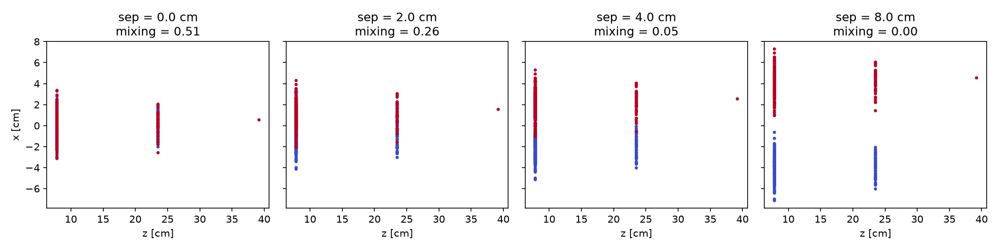
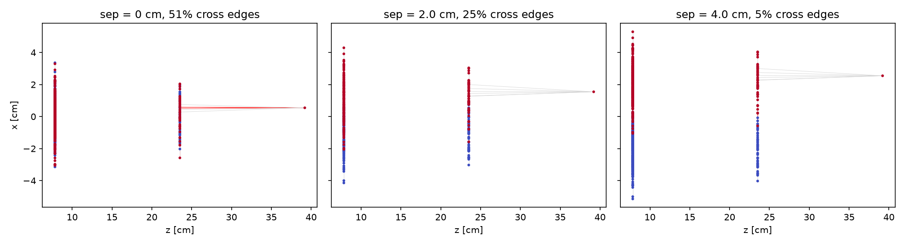

# calo-graph
calo-graph: separating overlapping showers with a GNN using truth labels. 
_Project idea: development of a Toy caloerimtric GNN for shower separation._
  

Toy project exploring graph neural networks for separating overlapping
particle showers in a layered calorimeter, using simulation truth for labels.

**Scope.** Events are generated from a simple shower model, with each hit
keeping the ID of its truth particle. Hits are connected in a graph, and a GNN
is trained to decide whether two hits come from the same particle (edge
classification), from which clusters are built. The focus is on merged
topologies (two close showers), as a small-scale analogue of truth-based
clustering and association in calorimeter reconstruction (e.g. HGCAL/TICL).
This is a learning project on **simulated toy data**, not a realistic detector
simulation, and it runs on CPU only.

## Status
Work in progress. See the repository issues and pull requests for progress.
- [x] Repository, CI (pytest on every pull request)
- [x] Toy shower generator with truth particle IDs
- [x] Merged-shower mode eith tunable separation
- [x] Graph construction and truth edge labels
- [] GNN edge classifier and baseline
- [] Evaluation (purity, efficiency, split/merge rate vs separation)

## Installation
Requires Python 3.10 or newer (developed on 3.14).

```bash
git clone https://github.com/enzoPG97/calo-graph.git
cd calo-graph
python3 -m venv .venv
source .venv/bin/activate          # Windows: .venv\Scripts\Activate.ps1
pip install torch --index-url https://download.pytorch.org/whl/cpu
pip install torch_geometric
pip install -e ".[dev]"
```

The CPU build of PyTorch is enough for this project. For a GPU, take the
install command for your CUDA version from pytorch.org instead.

## Quick start

```python
  from calograph import generate_pair_event
  from calograph.graph import build_graph, to_pyg

  event = generate_pair_event(separation_cm=2.0, seed=7)
  data = to_pyg(build_graph(event, k=8))
  print(data)    # Data(x=[~790, 4], edge_index=[2, ~8000], edge_attr=..., edge_label=...)
```

Each hit has a position (`x`, `y`, `z`), `energy`, `time`, `layer`, and the
truth `particle_id`. The same seed always gives the same event.

To plot examples:

```bash
python examples/plot_event.py
python examples/plot_separation.py
python examples/plot_graph.py
```

## Shower model

The generator follows a simplified version of the parametrisation in the PDG
review "Passage of particles through matter" (section "Electromagnetic
cascades"): a gamma-distribution longitudinal profile and a Gaussian
transverse profile scaled to the Moliere radius. All constants are toy values
and do not describe a real material or detector.

## Merged showers and truth

`generate_pair_event(separation_cm, ...)` places two showers with their axes a
chosen distance apart, in a random direction in the transverse plane. Every
hit keeps the ID of the particle that produced it (0 or 1), which is the truth
used later to label graph edges.



The **mixing fraction** measures how merged an event is: for each hit, look at
its nearest other hit and count how often it belongs to the other particle. It
is 0 for cleanly separated showers and about 0.5 for fully overlapping showers
of similar size.

| Separation | 0 cm | 2 cm | 4 cm | 8 cm |
|---|---|---|---|---|
| Mixing fraction | 0.51 | 0.22 | 0.03 | 0.00 |

Two 20 GeV electrons, default toy detector (Moliere radius 2 cm), mean over 5
seeds. Below about 4 cm (two Moliere radii) the showers are genuinely merged,
and this is the regime the classifier will be tested on.

## Graph construction
`build_graph(Event,...)` creates the graph using cKDTree from scipy.spatial and then it is convert to a `torch_geometric.data.Data` object using `to_pyg(Hitgraph)`. 
The graph is bult choosing the nearest neighbours in (x,y,z) direction or from all pairs closer than a givne radius. Time is kept as a feature for this toy model. 
Edege label is define as equal to one if both hits come from the same truth particle.



Below are the table of positive-edege fractions for different separation distances:
| Separation [cm] | Same-particle edges | Hits | Edges |
|---|---|---|---|
| 0 | 0.49 | 800 | 7746 |
| 1 | 0.60 | 800 | 7715 |
| 2 | 0.76 | 800 | 7738 |
| 4 | 0.96 | 800 | 7767 |
| 8 | 1.00 | 800 | 7856 |
| 15 | 1.00 | 800 | 7856 |

## Tests

```bash
pytest -v
```

The tests check reproducibility, the shower shape (mean depth, 90% of hits
within one Moliere radius), truth ID and energy bookkeeping, and that the
mixing fraction falls as the separation grows.

## Limitations

- Simulated toy data only, no real detector geometry or full simulation.
- Electron-like showers only, with no hadronic showers or noise yet.
- Every hit of a shower carries the same energy, and there is no readout
  threshold or noise.
- Not intended to reproduce any specific experiment's performance.

